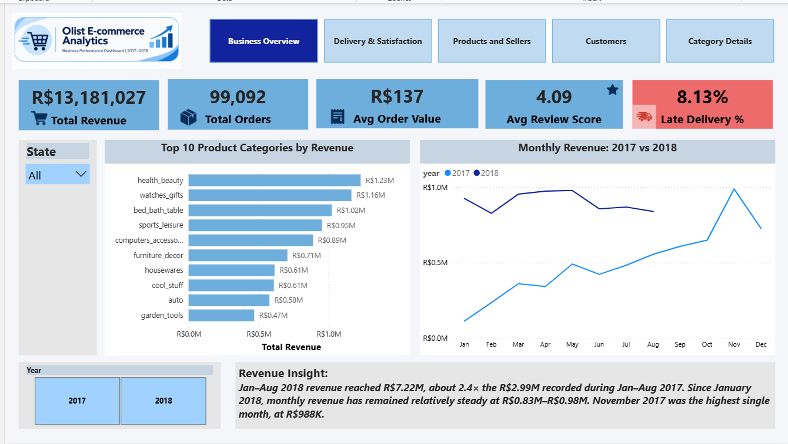
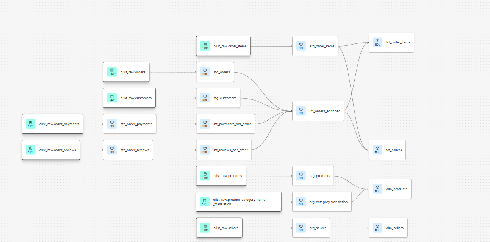
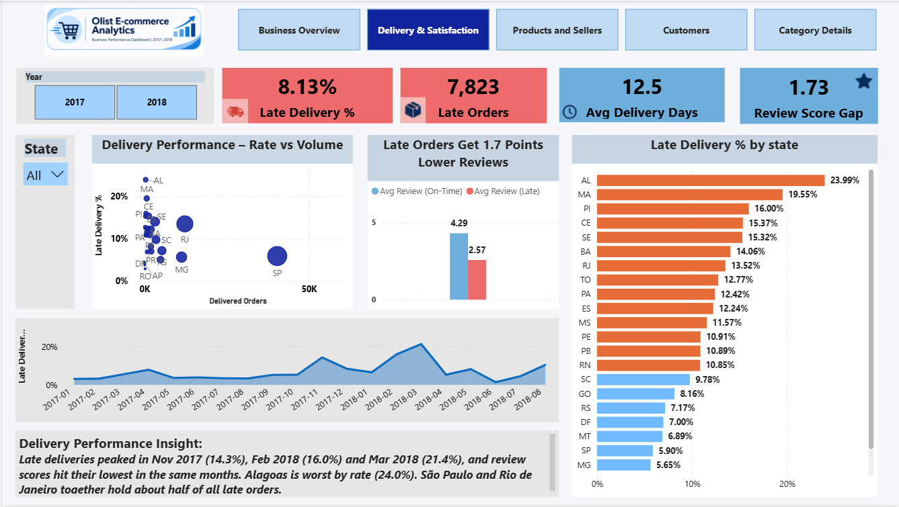
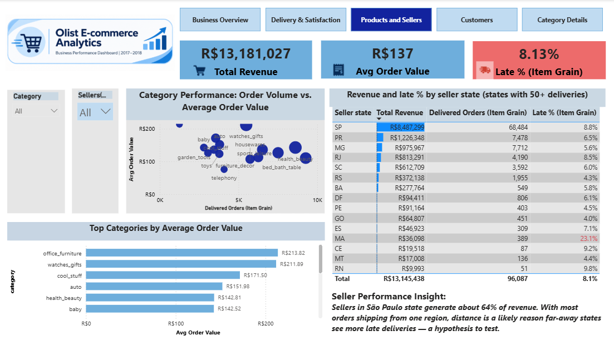
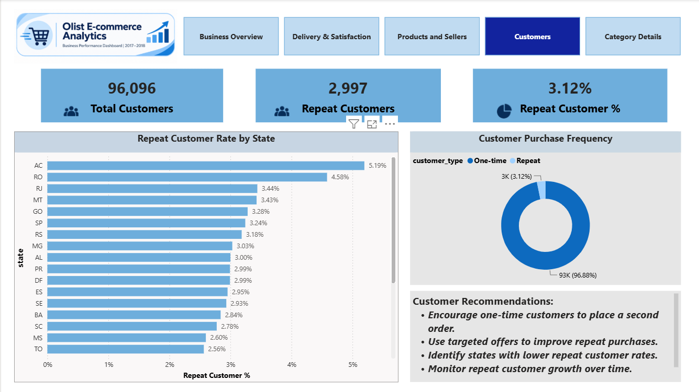
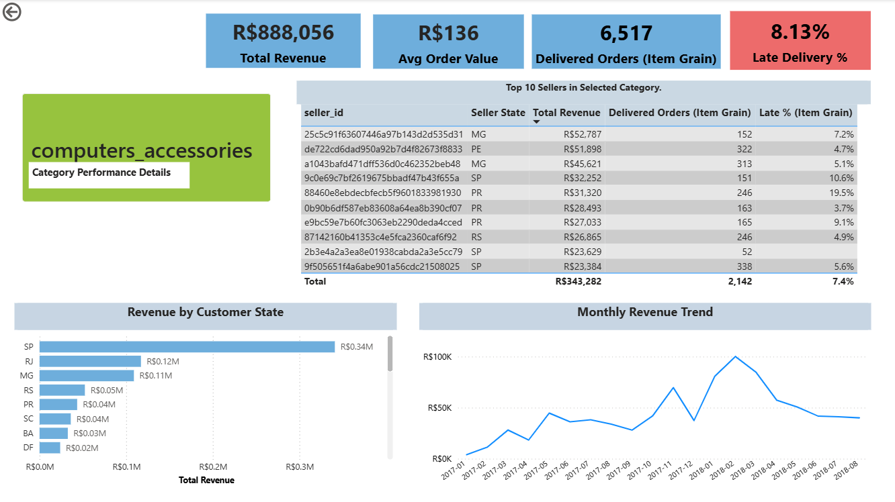

# Olist E-Commerce Analytics: BigQuery → dbt → Power BI

> An end-to-end analytics project on the public **Olist Brazilian E-Commerce dataset**: raw CSV files loaded into BigQuery, cleaned and modelled with dbt Cloud into a star schema, then analysed in a 5-page Power BI dashboard.



---

## 1. Project Summary

Olist is a Brazilian marketplace that connects small sellers to large online stores. The public dataset holds about **100,000 real orders (2016–2018)** across 9 related tables.

**What I built**

| Layer | Tool | What it does |
|-------|------|--------------|
| Warehouse | Google BigQuery | Stores the 9 raw tables |
| Transformation | dbt Cloud + SQL | Staging → intermediate → marts, with tests |
| Model | Star schema | 2 fact tables + 4 dimension tables |
| Reporting | Power BI | Data model, DAX measures, 4 report pages + 1 drill-through page |
| Version control | Git, GitHub, VS Code | dbt and Power BI (.pbip) files |

**Scope of the dashboard:** orders placed **Jan 2017 – Aug 2018**. The dataset also has 329 orders from 2016 and 20 from Sep–Oct 2018. These are left out because those months are too sparse to compare fairly.

**Business questions answered**

1. How fast is the business growing, and which categories and states drive revenue?
2. How often are deliveries late, and what does lateness do to customer reviews?
3. Which categories and seller regions earn the most, and where is revenue concentrated?
4. Do customers come back?

---

## 2. Headline Numbers (Jan 2017 – Aug 2018)

| Metric | Value |
|--------|-------|
| Revenue (item price, delivered orders) | **R$13.18M** |
| Orders | **99,092** |
| Average order value (delivered orders) | **R$137** |
| Average review score | **4.09 / 5** |
| Late delivery rate | **8.13%** (7,823 late orders) |
| Average delivery time | **12.5 days** |
| Unique customers | **96,096** |
| Repeat customers | **2,997 (3.12%)** |
| Sellers | **3,095** |

> **How the numbers are defined:** revenue is the item price of **delivered** orders and **does not include freight**. Average order value is revenue ÷ delivered orders. An order is "late" when it arrives after the estimated delivery date.

---

## 3. Architecture

```
Kaggle CSV (9 files)
        │
        ▼
 BigQuery (raw tables)
        │
        ▼
 dbt Cloud ──  staging       8 models: clean names, cast types
           ──  intermediate  3 models: joins and business logic
           ──  marts         6 models: star schema (facts + dimensions), tested
        │
        ▼
 Power BI (Import mode)  →  semantic model + DAX  →  5 report pages
```

### dbt models

| Layer | Models | Purpose |
|-------|--------|---------|
| **Staging** (`models/staging`) | `stg_orders`, `stg_order_items`, `stg_order_payments`, `stg_order_reviews`, `stg_customers`, `stg_products`, `stg_sellers`, `stg_category_translation` | One model per raw table: rename columns, cast data types, translate category names to English |
| **Intermediate** (`models/intermediate`) | `int_orders_enriched`, `int_payments_per_order`, `int_reviews_per_order` | Business logic: delivery days and late flag, payments summed per order, one review per order |
| **Marts** (`models/marts`) | `fct_orders`, `fct_order_items`, `dim_customers`, `dim_products`, `dim_sellers`, `dim_date` | Final star schema that Power BI reads |



*dbt lineage: 8 staging models feed 3 intermediate models, which build the 6 mart tables that Power BI reads.*


Model documentation and tests are defined in `_sources.yml`, `_staging.yml`, `_intermediate.yml` and `_marts.yml`.

### Star schema used in Power BI

| Table | Type | Grain (one row =) |
|-------|------|-------------------|
| `fct_orders` | Fact | one order (status, dates, delivery days, late flag, review score) |
| `fct_order_items` | Fact | one item inside an order (price, freight, seller, product) |
| `dim_customers` | Dimension | one unique customer (`customer_unique_id`, state, repeat flag) |
| `dim_products` | Dimension | one product (category) |
| `dim_sellers` | Dimension | one seller (city, state) |
| `dim_date` | Dimension | one calendar day |

**Relationships (all many-to-one, single direction)**

```
dim_customers ──► fct_orders          dim_customers ──► fct_order_items
dim_date      ──► fct_orders          dim_date      ──► fct_order_items
                                      dim_products  ──► fct_order_items
                                      dim_sellers   ──► fct_order_items
```

**Design note:** the two fact tables are not joined to each other. Category and seller filters reach `fct_order_items`, but not `fct_orders`. For this reason the model has **two sets of delivery measures**: an *order-grain* set (used on the overview, delivery and customer pages) and an *item-grain* set (used on the category and seller pages).

---

## 4. Connecting Power BI to the Data

1. **Home → Get Data → Google BigQuery**, then sign in
2. Pick the **marts dataset** and load only the `fct_*` and `dim_*` tables
3. Use **Import** mode (the data is small, and visuals stay fast)
4. Build the relationships shown above in **Model view**
5. Create the measures in a dedicated `Measures_` table, organised in display folders (Revenue, Orders, Delivery, Reviews, Customers, Time Comparison, Item Grain)

### Key DAX measures (from the model)

```DAX
Total Orders = DISTINCTCOUNT ( fct_orders[order_id] )

Total Revenue =
CALCULATE ( SUM ( fct_order_items[price] ), fct_order_items[order_status] = "delivered" )

Avg Order Value =
DIVIDE (
    [Total Revenue],
    CALCULATE ( DISTINCTCOUNT ( fct_order_items[order_id] ), fct_order_items[order_status] = "delivered" )
)

Delivered Orders =
CALCULATE ( [Total Orders], FILTER ( fct_orders, NOT ISBLANK ( fct_orders[is_late] ) ) )

Late Orders = CALCULATE ( [Total Orders], fct_orders[is_late] = TRUE )

-- Shows 0% (not blank) when orders were delivered but none were late
Late Delivery % =
VAR Delivered = [Delivered Orders]
RETURN
    IF ( NOT ISBLANK ( Delivered ), DIVIDE ( COALESCE ( [Late Orders], 0 ), Delivered ) )

Avg Review (Late) =
CALCULATE ( [Avg Review Score], FILTER ( fct_orders, fct_orders[is_late] = TRUE ) )

Revenue LY =
CALCULATE ( [Total Revenue], SAMEPERIODLASTYEAR ( dim_date[date_day] ) )

-- Item-grain versions (used for category and seller views)
Late % (Item Grain) =
VAR Delivered = [Delivered Orders (Item Grain)]
RETURN
    IF ( NOT ISBLANK ( Delivered ), DIVIDE ( COALESCE ( [Late Orders (Item Grain)], 0 ), Delivered ) )
```

---

## 5. Dashboard Pages

| Page | Screenshot | What it shows |
|------|-----------|---------------|
| 1. Business Overview |  | KPI cards, top 10 categories by revenue, monthly revenue 2017 vs 2018 |
| 2. Delivery & Satisfaction |  | Late % by state and by month, review score on-time vs late |
| 3. Products and Sellers |  | Category volume vs order value, revenue and late % by seller state |
| 4. Customers |  | One-time vs repeat customers, repeat rate by state |
| 5. Category Details (drill-through) |  | One category: KPIs, top 10 sellers, revenue by customer state, monthly trend |

---

## 6. Key Insights

> All numbers below were checked against the Power BI model.

### 1. Growth was fast in 2017, then flattened in 2018
- Jan–Aug 2018 revenue was **R$7.22M**, about **2.4×** Jan–Aug 2017 (R$2.99M). Most of this jump comes from 2017 being a small, ramp-up base.
- Monthly revenue stayed between **R$0.83M and R$0.98M** all of 2018. It peaked at **R$978K in May 2018** and fell to **R$839K by August (−14%)**.
- **November 2017 (Black Friday)** was the highest month at **R$988K** and 7,544 orders.

**So what:** growth had stopped by mid-2018. The business needs new demand (new regions, repeat buyers), not just more of the same.

### 2. Late deliveries are the biggest threat to customer happiness
- Late orders average **2.57 stars**; on-time orders average **4.29**, a gap of about **1.7 points**.
- **56% of late orders get a 1–2 star review**, compared with **12%** of on-time orders. Only **22%** of late orders get 5 stars, compared with **61%** of on-time orders.
- The three worst months for lateness were also the three worst for reviews:

| Month | Late % | Avg delivery days | Avg review |
|-------|--------|-------------------|------------|
| Nov 2017 | 14.3% | 15.1 | 3.91 |
| Feb 2018 | 16.0% | 16.9 | 3.83 |
| Mar 2018 | **21.4%** | 16.2 | **3.75** |

**So what:** the peak sales month (Nov 2017) was also when delivery broke down. Peak periods need extra carrier capacity planned in advance. (This is a strong link, but it shows association, not proof of cause.)

### 3. Delivery problems are about geography, not product type
- Late % by customer state ranges from **5.6% (MG)** to **24.0% (Alagoas)**. Other weak states: MA 19.6%, PI 16.0%, CE 15.4%, SE 15.3%.
- Across the big categories, late % barely changes (most sit between **7% and 9%**). The product matters much less than where it ships.
- **Rio de Janeiro is the biggest fixable problem.** It is the 3rd largest market (12,312 delivered orders), but has a **13.5% late rate**, a **3.88** average review (SP: 4.18), and produces **21% of all late orders**. São Paulo and Rio together produce about **52%** of all late orders.

### 4. Seller distance is a likely driver
- **64% of revenue comes from sellers in São Paulo state**, and SP + PR + MG sellers together make **81%**.
- Orders where the seller and customer are in the **same state** are late **6.1%** of the time and take **7.8 days** on average.
- **Cross-state orders** (about 64% of all orders) are late **9.3%** of the time and take **15.0 days**.

**So what:** adding sellers or stock closer to the Northeast and Rio would likely cut lateness. This is a hypothesis supported by the data, not a proven cause.

### 5. Late % alone hides the longest waits
Remote northern states have a *low* late rate but the *longest* delivery times:

| State | Avg delivery days | Late % |
|-------|------------------|--------|
| SP | 8.7 | 5.9% |
| RJ | 15.2 | 13.5% |
| AL | 24.5 | 24.0% |
| AM | 26.4 | 4.1% |
| AP | 27.2 | 4.5% |
| RR | 29.9 | 12.5% (only 40 orders) |

Customers in AM and AP wait **three times longer than São Paulo**, but are rarely "late" because the promised dates were already long. Both measures are needed to judge delivery performance.

### 6. Revenue is spread across categories, but the top ones lead
- Top 5 categories (**Health & Beauty R$1.23M, Watches & Gifts R$1.16M, Bed/Bath/Table R$1.02M, Sports & Leisure R$0.95M, Computers & Accessories R$0.89M**) make **~40%** of revenue. The top 10 make **~62%**.
- **Watches & Gifts** earns both volume and value (average order R$212). **Bed/Bath/Table** is a volume category (9,267 delivered orders at R$110 each).

### 7. Freight eats a big share of the price on bulky, low-price categories
Overall, freight equals **16.6%** of item revenue. By category:

| Category | Freight as % of item revenue |
|----------|------------------------------|
| Office Furniture | 25% |
| Furniture Décor | 24% |
| Housewares | 23% |
| Telephony | 22% |
| Garden Tools | 21% |
| Bed/Bath/Table | 20% |
| Health & Beauty | 14% |
| Watches & Gifts | **8%** |

**So what:** shipping cost may hurt conversion in furniture and home categories. Free-shipping thresholds or regional stock there are worth testing.

### 8. A small group of sellers earns most of the revenue, with no single point of failure
- Of about 2,945 sellers with delivered sales, the **top 10% (≈295 sellers) earn 67% of revenue** and the **top 20% earn 82%**.
- The largest seller is only **1.7%** of revenue, and the top 10 sellers together make **13%**. Revenue is concentrated, but not dependent on one seller.

### 9. Almost every customer buys only once
- **96.9% of customers bought once**; only **2,997 (3.12%)** came back, and only 252 bought 3 or more times.
- Repeat customers make just **5.8% of revenue** and spend a little less per order (R$123 vs R$138).
- The repeat rate is similar in the big states (SP 3.2%, RJ 3.4%, MG 3.0%). Small states such as AC (5.2%) and RO (4.6%) look higher, but they have very few customers (77 and 240).
- Repeat customers had slightly fewer late orders (7.1% vs 8.2%), a small difference.

**So what:** Olist behaves like a one-time marketplace. A follow-up offer after a *good* delivery experience is the cheapest growth lever to test.

---

## 7. Drill-Through Example: Computers & Accessories

- Revenue **R$888K**, average order **R$136**, **6,517** delivered orders
- Item-grain late rate: **7.7%** (below the 8.1% company average)
- **São Paulo customers** bring the most revenue (R$0.34M), followed by RJ and MG
- Monthly revenue peaked at about **R$100K in Feb 2018**, then slowed to about R$40K per month by Aug 2018

---

## 8. Skills Demonstrated

- **Data warehousing:** BigQuery loading, SQL (joins, CTEs, aggregations, window logic)
- **Analytics engineering:** dbt layers (staging / intermediate / marts), testing, star-schema design
- **Data modelling:** fact and dimension tables, grain, relationships, why item-grain and order-grain measures differ
- **Power BI:** Import-mode model, DAX measures with display folders, time intelligence, drill-through, navigation
- **Business analysis:** turning data into findings with numbers, causes, and actions

---

## 9. Lessons Learned

- **Use `customer_unique_id`, not `customer_id`.** In Olist the second one changes with every order, so counting it makes everyone look like a new customer.
- **Respect the grain.** Mixing order-level and item-level tables multiplies rows. This is why the model uses two measure sets.
- **A filter only flows where a relationship exists.** A category filter does not reach `fct_orders`, so any measure on that table ignores it.
- **`DISTINCTCOUNT` returns blank, not 0, when there are no rows.** A seller with deliveries but no late orders showed a blank late %, not 0%. I fixed it with `COALESCE` inside the ratio measures, and kept the result blank only when nothing was delivered.
- **Write down every definition.** "Revenue" excludes freight and non-delivered orders, and the dashboard covers Jan 2017 – Aug 2018.

---

## 10. Limitations

- The data covers 2016–2018 only, and values are in Brazilian Real (R$).
- Revenue excludes freight and has no cost data, so this is **revenue analysis, not profit analysis**.
- "Late" is measured against Olist's *estimated* delivery date. Long estimates in remote states make lateness look better than the waiting time really is.
- About 770 orders have no review score.
- Seller-distance and review findings show association, not proven cause.

---

## 11. Future Improvements

- Add a delivery-days-by-state view and a review-score-by-month trend to the delivery page
- Add the same-state vs cross-state comparison as a visual
- Sentiment analysis on review comments (Python)
- RFM customer segmentation
- Schedule dbt runs and Power BI refresh

---

## 12. Repository Structure

```
Olist-Ecommerce-Analytics/
├── README.md
├── screenshots/                  # dashboard + lineage screenshots
├── models/
│   ├── staging/                  # _sources.yml, _staging.yml, stg_*.sql
│   ├── intermediate/             # _intermediate.yml, int_*.sql
│   └── marts/                    # _marts.yml, fct_*.sql, dim_*.sql
├── analyses/  macros/  seeds/  snapshots/  tests/
├── dbt_project.yml
├── .gitignore
└── powerbi/                      # .pbip project (report + semantic model)
```
---

## About Me

Programmer Analyst with experience in QA testing (automation, SQL, JIRA) and a master's degree in Mathematics, building data analyst skills with SQL, dbt, BigQuery, Power BI, Python and Excel.

**Connect:** [LinkedIn](www.linkedin.com/in/sunita-jangid-7a238b216) · [GitHub](https://github.com/Saanjh02/Saanjh02.git)

*Dataset: "Brazilian E-Commerce Public Dataset by Olist", Kaggle (CC BY-NC-SA 4.0).*